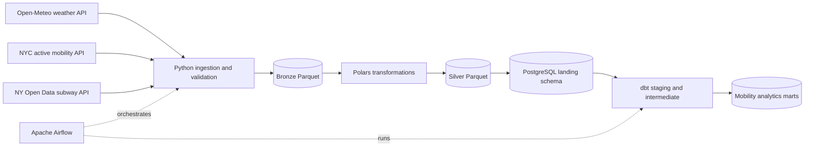

# NYC Mobility Data Platform

An end-to-end data engineering pet project that combines New York City
weather, active mobility, and subway ridership data in one analytical
platform.

The project ingests public APIs with Python, validates and stores partitioned
Bronze/Silver Parquet data, loads a PostgreSQL warehouse, builds analytical
models with dbt, and orchestrates the complete workflow with Apache Airflow.

## Architecture



This is a hybrid ETL/ELT design: Python performs source-specific cleaning and
validation before loading PostgreSQL, while dbt performs warehouse-side
business transformations.

## Data sources

| Dataset | Provider | Project use |
|---|---|---|
| [Historical Weather API](https://open-meteo.com/en/docs/historical-weather-api) | Open-Meteo | Hourly temperature, humidity, precipitation, rain, and wind |
| [Bicycle and Pedestrian Counts](https://data.cityofnewyork.us/Transportation/Bicycle-and-Pedestrian-Counts/ct66-47at/about_data) | NYC Open Data | Bicycle, pedestrian, and scooter counts with 15/60-minute intervals |
| [Active mobility sensors](https://data.cityofnewyork.us/d/6up2-gnw8) | NYC Open Data | Sensor location, recording interval, directionality, and travel modes |
| [Subway Ridership 2017–2019](https://data.ny.gov/Transportation/MTA-Subway-Hourly-Ridership-2017-2019/t69i-h2me/about_data) | NY Open Data | Historical hourly station ridership |
| [Subway Ridership 2020–2024](https://data.ny.gov/Transportation/MTA-Subway-Hourly-Ridership-2020-2024/wujg-7c2s/about_data) | NY Open Data | Historical hourly station ridership |
| [Subway Ridership 2025–present](https://data.ny.gov/Transportation/MTA-Subway-Hourly-Ridership-Beginning-2025/5wq4-mkjj/about_data) | NY Open Data | Current hourly station ridership |

The shared supported range begins on `2017-01-13`, when all three subject
areas are available. Before every run, orchestration checks the latest dates
published by the active mobility and subway sources.

## What the project demonstrates

- API ingestion with pagination, retries, and optional Socrata app tokens.
- Pydantic source models and Pandera/Polars dataframe validation.
- Monthly Bronze and Silver Parquet partitioning.
- Atomic, idempotent Parquet merge-and-replace writes by business key.
- Timezone normalization between `America/New_York` and UTC, including DST.
- PostgreSQL schemas managed by Alembic and idempotent warehouse upserts.
- dbt sources, staging views, intermediate models, facts, dimensions, marts,
  tests, and documentation.
- Parameterized Airflow DAGs for arbitrary date, month, and year ranges.
- Airflow pools that prevent concurrent writers from modifying the same
  datasource partitions or dbt models.
- A reproducible Docker Compose environment with health checks and automatic
  initialization.

## Quick start

### Requirements

- Git
- Docker Desktop, or Docker Engine with Docker Compose v2

Python does not need to be installed on the host for the Docker workflow.

### 1. Clone and start

```bash
git clone https://github.com/MagCyp/data_engineer_project.git
cd data_engineer_project
```

Windows PowerShell:

```powershell
powershell -ExecutionPolicy Bypass -File .\start.ps1
```

Linux or macOS:

```bash
sh ./start.sh
```

The scripts create writable runtime directories and execute:

```bash
docker compose up --build --wait
```

No `.env` file is required for local evaluation. On the first start Docker
automatically:

1. builds the project image and its isolated Python environment;
2. starts PostgreSQL;
3. creates the separate Airflow metadata database and user;
4. applies Airflow metadata migrations and creates the admin user;
5. runs `alembic upgrade head` for the project warehouse;
6. creates one-slot Airflow pools for every writer and for dbt;
7. starts the API/UI, scheduler, and DAG processor after their dependencies
   are ready.

### 2. Open Airflow

Open [http://localhost:8080](http://localhost:8080).

Default local credentials:

```text
username: airflow
password: airflow
```

These defaults are intended only for local development.

### 3. Run a small range

The DAGs are ready but intentionally have no automatic schedule. In the
Airflow UI, trigger `mobility_date_range` and provide a small published range:

```json
{
  "start_date": "2026-10-01",
  "end_date": "2026-10-02"
}
```

The graph executes:

```text
validate_dates
    ├── weather_pipeline
    ├── active_mobility_pipeline
    └── subway_pipeline
              ↓
          dbt_build
```

Start with one or two days. A full year can contain millions of source rows
and may require significant bandwidth, disk space, memory, and time.

## Available DAGs

| DAG | Parameters | Purpose |
|---|---|---|
| `mobility_date_range` | `start_date`, `end_date` as `YYYY-MM-DD` | Load any inclusive date range |
| `mobility_month_range` | `start_month`, `end_month` as `YYYY-MM` | Load one or more complete months |
| `mobility_year_range` | `start_year`, `end_year` as `YYYY` | Load one or more complete years |

Use the same start and end month/year to load a single period.

Each run validates source boundaries, runs the three independent data
pipelines in parallel, and starts `dbt build` only after all of them succeed.

## Configuration

Project and source configuration lives in
[`config/project.yml`](config/project.yml). It contains API endpoints,
resource IDs, source boundaries, locations, and storage paths.

Docker Compose has local defaults. To override them:

```powershell
Copy-Item .env.example .env
```

or:

```bash
cp .env.example .env
```

Important variables:

| Variable | Default | Description |
|---|---|---|
| `POSTGRES_PORT` | `5433` | Warehouse port exposed on the host |
| `AIRFLOW_PORT` | `8080` | Airflow UI/API port |
| `AIRFLOW_ADMIN_USERNAME` | `airflow` | Local Airflow account |
| `AIRFLOW_ADMIN_PASSWORD` | `airflow` | Local Airflow password |
| `SOCRATA_APP_TOKEN` | empty | Optional token for higher Socrata limits |

For anything beyond local development, replace every default password,
Fernet key, API secret, and JWT secret in `.env`.

## Storage and warehouse layers

```text
data/
├── bronze/<pipeline>/year=YYYY/month=MM/
└── silver/<pipeline>/year=YYYY/month=MM/

PostgreSQL
├── landing     # validated Silver records loaded by Python
└── analytics   # dbt staging, intermediate, facts, dimensions, and marts
```

The dbt project materializes staging and intermediate models as views and
marts as tables. Main analytical outputs include:

- `fct_weather_hourly`
- `fct_active_mobility_counts_hourly`
- `fct_subway_ridership_hourly`
- `dim_date`
- `dim_active_mobility_sensor`
- `dim_subway_station`
- `active_mobility_weather_daily`
- `subway_weather_daily`
- `mobility_weather_daily`

## Useful commands

Check service health:

```bash
docker compose ps -a
```

Follow initialization logs:

```bash
docker compose logs -f airflow-init
```

Check DAG imports:

```bash
docker compose exec airflow-scheduler airflow dags list-import-errors
```

Open PostgreSQL's interactive shell with the default local configuration:

```bash
docker compose exec postgres_db psql -U data_platform_user -d data_platform_dw
```

Stop services while preserving PostgreSQL and Airflow metadata:

```bash
docker compose down
```

To rebuild after dependency or Dockerfile changes:

```bash
docker compose up --build --wait
```

Python source files, DAGs, configuration, dbt models, data, and logs are bind
mounted, so ordinary code changes do not require an image rebuild.

> `docker compose down -v` also removes the PostgreSQL volume and permanently
> deletes locally loaded warehouse data and Airflow metadata.

## Local development and tests

The host development environment requires Python 3.14:

```bash
python -m venv .venv
python -m pip install --upgrade pip
python -m pip install -e ".[dev]"
python -m ruff check .
python -m pytest -q
```

The test suite covers API clients, pagination, validation, transformations,
partition merging, warehouse upserts, CLI parsing, and orchestration date
resolution. dbt tests run as part of every successful Airflow workflow.

## Repository structure

```text
airflow/dags/               Airflow DAG definitions
alembic/                    PostgreSQL landing-schema migrations
config/project.yml          APIs, datasets, source limits, and storage paths
data_platform_analytics/    dbt project
docker/postgres/            Airflow metadata database bootstrap SQL
src/                        Python pipelines and shared infrastructure
tests/                      Python test suite
Dockerfile                  Shared project and Airflow image
docker-compose.yml          Local platform services and initialization
```

## Current scope

- DAGs are manually triggered; a publication-aware automatic schedule is
  intentionally deferred.
- Socrata works without an app token, but authenticated requests usually have
  better rate limits.
- The project is designed for local learning and portfolio demonstration, not
  as a production deployment template.
