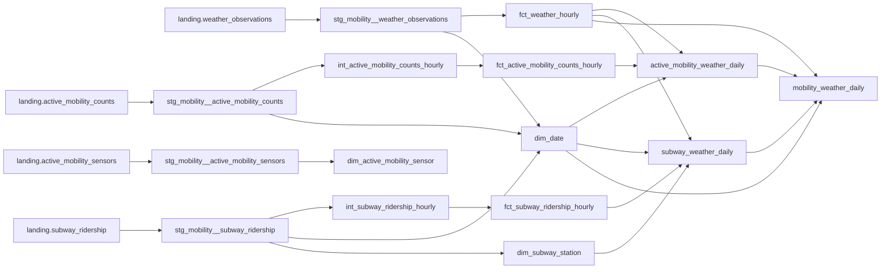

# Mobility Analytics dbt Project

This directory contains the dbt transformation and analytics layer for the
[NYC Mobility Data Platform](../README.md). Python pipelines ingest and
normalize source data into PostgreSQL's `landing` schema; dbt then builds
documented, tested analytical models in the `analytics` schema.

## Architecture



The project uses the following layer conventions:

| Layer | Materialization | Responsibility |
|---|---|---|
| Sources | Existing `landing` tables | Data loaded by the Python pipelines |
| Staging | Views | Explicit source selection, stable names and source-grain preservation |
| Intermediate | Views | Reusable hourly aggregation and quality counters |
| Dimensions | Tables | Descriptive entities and the local calendar |
| Facts | Tables | Tested hourly business events and completeness flags |
| Analytics | Tables | Daily weather/mobility datasets intended for analysis |

## Important data semantics

- Event timestamps are stored in UTC. `date_day` is derived in the
  `America/New_York` timezone with the `to_mobility_date` macro.
- A New York local day can contain 23, 24, or 25 UTC hours because of daylight
  saving time. `dim_date.expected_hour_count` is the authoritative expected
  number of hours for daily completeness checks.
- Observed totals are not silently converted to estimated citywide totals.
  Missing entities reduce coverage; missing activity remains `NULL`, not zero.
- `subway_ridership.transfers` is already included in `ridership`. Do not add
  the two columns together when calculating passenger volume.
- Active-mobility source rows can have 15- or 60-minute intervals. Hourly
  completeness is therefore evaluated from each row's `interval_minutes`, not
  from one global interval.
- Models preserve published negative subway transfer values instead of
  replacing them with zero or taking their absolute value.

## Source tables

All sources belong to the dbt source named `mobility` and resolve to the
PostgreSQL `landing` schema.

| Source table | Grain | Contents |
|---|---|---|
| `weather_observations` | One location and UTC observation hour | Temperature, humidity, precipitation, rain and wind speed |
| `active_mobility_counts` | One flow, timestamp and measurement interval | Bike, pedestrian and scooter counts with direction and source status |
| `active_mobility_sensors` | One sensor | Current sensor metadata, location, recording interval and supported modes |
| `subway_ridership` | One station, transit mode, UTC hour, payment method and fare class | MTA ridership, transfers and station attributes |

Source definitions and source-level tests are in
[`models/staging/_sources.yml`](models/staging/_sources.yml).

## Complete model catalog

### Staging models

Staging models read through `source()`, explicitly select columns and preserve
the landing-table grain. They do not aggregate, deduplicate or remove source
rows.

#### `stg_mobility__weather_observations`

- **Materialization:** view
- **Input:** `source('mobility', 'weather_observations')`
- **Grain:** one `location` and `observed_at_utc`
- **Purpose:** exposes normalized hourly weather measurements without changing
  their granularity.
- **Main fields:** `location`, `timezone`, `observed_at_utc`, `temperature_c`,
  `relative_humidity_pct`, `precipitation_mm`, `rain_mm`, `wind_speed_kmh`,
  `ingested_at`.

#### `stg_mobility__active_mobility_counts`

- **Materialization:** view
- **Input:** `source('mobility', 'active_mobility_counts')`
- **Grain:** one `flow_id`, `observed_at_utc` and `interval_minutes`
- **Purpose:** exposes bike, pedestrian and scooter interval measurements while
  retaining directional flow, interval, lifecycle status and ingestion data.
- **Main fields:** `sensor_id`, `flow_id`, `flow_name`, `travel_mode`,
  `direction`, `observed_at_local`, `observed_at_utc`, `interval_minutes`,
  `mobility_count`, `source_status`, `ingested_at`.
- **Valid travel modes:** `bike`, `pedestrian`, `scooter`.
- **Valid source statuses:** `raw`, `modified`, `deleted`.

#### `stg_mobility__active_mobility_sensors`

- **Materialization:** view
- **Input:** `source('mobility', 'active_mobility_sensors')`
- **Grain:** one `sensor_id`
- **Purpose:** exposes the current sensor metadata snapshot used by dimensions
  and relationship tests.
- **Main fields:** sensor name and coordinates, timezone, first/last observed
  timestamp, recording interval, supported travel modes, directional and
  weather flags, operator and ingestion timestamp.

#### `stg_mobility__subway_ridership`

- **Materialization:** view
- **Input:** `source('mobility', 'subway_ridership')`
- **Grain:** one station complex, transit mode, UTC hour, payment method and
  fare-class category
- **Purpose:** exposes MTA rows at their original analytical grain before fare
  and payment categories are aggregated.
- **Main fields:** local/UTC timestamp, station and borough attributes,
  `payment_method`, `fare_class_category`, `ridership`, `transfers`, coordinates
  and `ingested_at`.

### Intermediate models

Intermediate models contain reusable aggregation logic. They remain views so
facts always use the current staging data.

#### `int_active_mobility_counts_hourly`

- **Materialization:** view
- **Input:** `stg_mobility__active_mobility_counts`
- **Grain:** one `flow_id` and UTC hour
- **Purpose:** aggregates 15- or 60-minute measurements into directional hourly
  counts without hiding incomplete hours.
- **Aggregation:** `raw` and `modified` non-null values contribute to
  `mobility_count`; deleted or null-value rows are counted as problems.
- **Quality fields:**
  - `source_record_count`: every interval received for the hour;
  - `valid_source_record_count`: usable raw/modified intervals;
  - `problem_source_record_count`: deleted intervals or intervals with no value;
  - `latest_ingested_at`: latest source ingestion timestamp in the hour.

#### `int_subway_ridership_hourly`

- **Materialization:** view
- **Input:** `stg_mobility__subway_ridership`
- **Grain:** one `station_complex_id`, `transit_mode` and `observed_at_utc`
- **Purpose:** removes fare/payment dimensions from the hourly business grain
  while preserving audit counts.
- **Aggregation:** sums `ridership` and `transfers`; counts distinct payment
  methods and fare classes; records the number of source rows and latest
  ingestion timestamp.
- **Excluded attributes:** station name, borough and coordinates belong in
  `dim_subway_station`, so they cannot accidentally split hourly totals.

### Dimension models

#### `dim_date`

- **Materialization:** table
- **Inputs:** all three event staging models
- **Grain:** one New York local `date_day`
- **Purpose:** creates a continuous date spine between the minimum and maximum
  dates present in the loaded sources.
- **Attributes:** year, quarter, month, month name, day of month, ISO weekday,
  weekend flag and meteorological season.
- **DST field:** `expected_hour_count` is 23, 24 or 25 and is calculated from
  New York timezone boundaries for each date.

#### `dim_active_mobility_sensor`

- **Materialization:** table
- **Input:** `stg_mobility__active_mobility_sensors`
- **Grain:** one `sensor_id`
- **Purpose:** provides sensor name, operator, location, timezone, observed date
  range, recording interval, supported modes and source capability flags.
- **Join key:** `sensor_id`.

#### `dim_subway_station`

- **Materialization:** table
- **Input:** `stg_mobility__subway_ridership`
- **Grain:** one `station_complex_id`
- **Purpose:** stores station-complex name, borough and coordinates separately
  from ridership facts.
- **Conflict handling:** the model retains distinct source attribute
  combinations. If one ID has conflicting attributes, its uniqueness test
  fails instead of silently selecting an arbitrary value.

### Fact models

#### `fct_weather_hourly`

- **Materialization:** table
- **Input:** `stg_mobility__weather_observations`
- **Grain:** one `location` and `observed_at_utc`
- **Purpose:** provides the hourly weather fact and adds the corresponding New
  York `date_day` for joins with mobility facts and the date dimension.
- **Measures:** temperature, relative humidity, precipitation, rain and wind
  speed.

#### `fct_active_mobility_counts_hourly`

- **Materialization:** table
- **Input:** `int_active_mobility_counts_hourly`
- **Grain:** one directional `flow_id` and UTC hour
- **Purpose:** publishes hourly active-mobility counts with an explicit and
  interval-aware completeness result.
- **`expected_record_count`:** `60 / interval_minutes`, therefore 4 records for
  a 15-minute flow and 1 record for a 60-minute flow.
- **`is_complete_hour`:** true only when total records and valid records both
  equal the expected count and `problem_source_record_count` is zero.
- **Observed totals:** `mobility_count` is retained even for incomplete hours;
  consumers must use `is_complete_hour` when they require comparable coverage.

#### `fct_subway_ridership_hourly`

- **Materialization:** table
- **Input:** `int_subway_ridership_hourly`
- **Grain:** one station complex, transit mode and UTC hour
- **Purpose:** publishes hourly station-level ridership and adds the New York
  local `date_day`.
- **Measures:** `ridership`, `transfers`, represented payment/fare counts and
  `source_record_count`.

### Analytics models

#### `active_mobility_weather_daily`

- **Materialization:** table
- **Inputs:** `fct_active_mobility_counts_hourly`, `fct_weather_hourly`,
  `dim_date`
- **Grain:** one local `date_day`, `sensor_id`, `flow_id` and `travel_mode`
- **Purpose:** combines daily flow-level bike, pedestrian or scooter activity
  with daily New York weather.
- **`mobility_count`:** observed sum, including values from incomplete hours.
- **`valid_hours`:** number of hours where `is_complete_hour` is true.
- **`is_complete_day`:** true when `valid_hours` equals
  `dim_date.expected_hour_count`, including 23/25-hour DST dates.
- **Weather fields:** average temperature, total precipitation, average wind
  speed and rainy-day flag.

#### `subway_weather_daily`

- **Materialization:** table
- **Inputs:** `fct_subway_ridership_hourly`, `fct_weather_hourly`, `dim_date`,
  `dim_subway_station`
- **Grain:** one local `date_day` and `station_complex_id`
- **Purpose:** combines daily station-complex ridership with station borough and
  daily New York weather.
- **Measures:** `total_ridership`, `total_transfers`, `observed_hours`.
- **`is_complete_day`:** true when distinct observed UTC hours equal the date
  dimension's expected 23, 24 or 25 hours.
- **Join behavior:** dimension and weather joins are left joins. Ridership is
  retained if descriptive station attributes or weather are unavailable.

#### `mobility_weather_daily`

- **Materialization:** table
- **Inputs:** `active_mobility_weather_daily`, `subway_weather_daily`,
  `fct_weather_hourly`, `dim_date`
- **Grain:** one New York local `date_day`
- **Purpose:** final cross-mode analytical mart for comparing weather with
  observed bike, pedestrian and subway activity.
- **Date coverage:** the result is anchored on available New York weather days.
- **Observed measures:** bike and pedestrian flow sums, subway ridership, and
  the number of reporting sensors/stations. They describe received data and are
  not coverage-adjusted citywide estimates.
- **Stable sample:** eligibility is calculated independently for bike sensors,
  pedestrian sensors and subway stations over the calendar period from that
  mode's first to last loaded date. Calendar gaps count as missing coverage.
- **Active-mobility sensor day:** complete only when every flow observed for the
  sensor/mode is present and each flow has a complete day.
- **Entity eligibility:** at least `activity_min_complete_days` complete days,
  complete-day coverage of at least `activity_min_entity_coverage`, and a
  positive own baseline.
- **Own baseline:** an entity's average activity over its complete days.
- **Activity index:** equal-weight average of
  `entity_daily_activity / entity_own_baseline` across complete eligible
  entities. A value of `1.0` means the participating stable sample is at its
  own baseline on average.
- **Daily publication rule:** the index is `NULL` unless complete eligible
  entities cover at least `activity_min_daily_coverage` of the stable sample.
- **Coverage fields:** `*_reporting_*`, `*_eligible_*`, `*_complete_*` and
  `*_coverage_ratio` make missing-data effects visible to downstream users.

## Project variables

Variables are defined in [`dbt_project.yml`](dbt_project.yml):

| Variable | Default | Meaning |
|---|---:|---|
| `mobility_timezone` | `America/New_York` | Timezone used to derive local dates and DST-aware day lengths |
| `mobility_weather_location` | `New York` | Weather location included in daily mobility marts |
| `rainy_day_threshold_mm` | `0` | Daily rain must exceed this threshold for `is_rainy_day` |
| `activity_min_complete_days` | `14` | Minimum complete days required for stable-sample eligibility |
| `activity_min_entity_coverage` | `0.9` | Minimum complete-day calendar coverage for an entity |
| `activity_min_daily_coverage` | `0.9` | Minimum stable-sample coverage required to publish a daily index |

## Shared macros

- `to_mobility_date(timestamp_expression)` converts a UTC timestamp to the
  configured mobility timezone and returns its local calendar date.
- `decimal_comma_to_numeric(column_name, precision, scale)` normalizes a
  decimal-comma string and casts it to a PostgreSQL numeric type.

## Data quality and tests

The project uses three complementary test types:

- **Generic tests** in model YAML validate `not_null`, `unique`, relationships,
  accepted values and dimension coverage.
- **Singular tests** in `tests/` validate business grain, preservation of
  observed totals, source cadence and valid coverage/index combinations.
- **Unit tests** provide small fixtures for incomplete intervals, DST days,
  missing dimensions, stable samples, own baselines, zero baselines, calendar
  gaps and empty activity sources.

Run the complete project from the project container:

```bash
dbt build \
  --project-dir /opt/airflow/project/data_platform_analytics \
  --profiles-dir /opt/airflow/project/data_platform_analytics
```

Run only dbt unit tests:

```bash
dbt test \
  --project-dir /opt/airflow/project/data_platform_analytics \
  --profiles-dir /opt/airflow/project/data_platform_analytics \
  --select "test_type:unit"
```

The Airflow mobility DAGs execute the complete dbt build after all ingestion
tasks for a run succeed.

## Documentation and lineage graph

From the repository root, start the optional dbt Docs service:

```bash
docker compose --profile docs up -d --wait dbt-docs
```

Open [http://localhost:8081](http://localhost:8081) to browse models, columns,
tests, sources, compiled SQL and the interactive lineage graph. Restart
`dbt-docs` after changing dbt files so it regenerates `manifest.json` and
`catalog.json`. The dbt process listens on port `8080` inside its container;
Docker Compose maps it to port `8081` on the host.

Without the Docker service, generate and serve the documentation directly from
the repository root:

```bash
dbt docs generate \
  --project-dir data_platform_analytics \
  --profiles-dir data_platform_analytics

dbt docs serve \
  --project-dir data_platform_analytics \
  --profiles-dir data_platform_analytics \
  --port 8080
```
